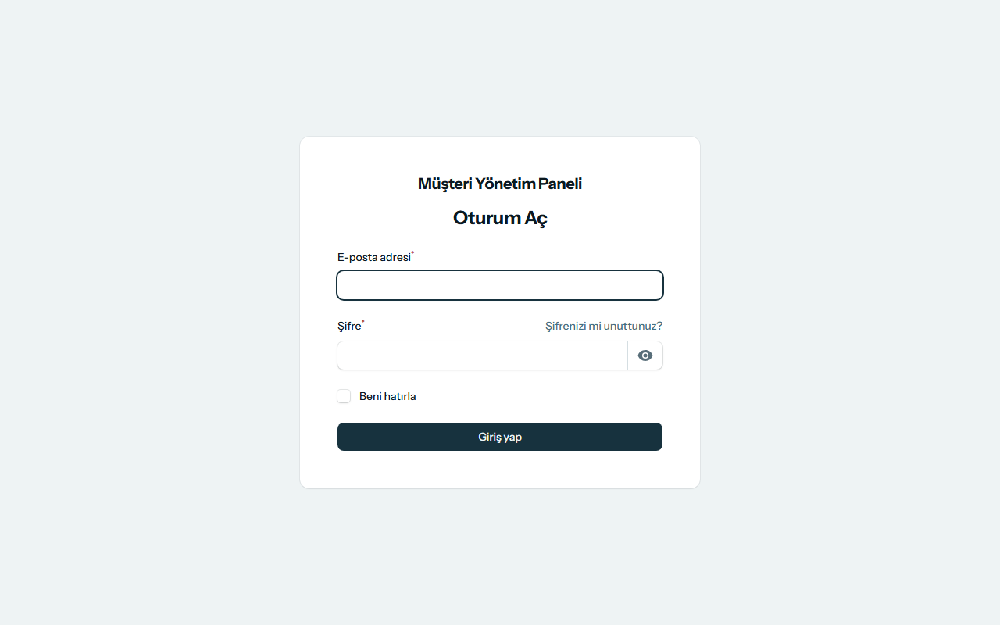
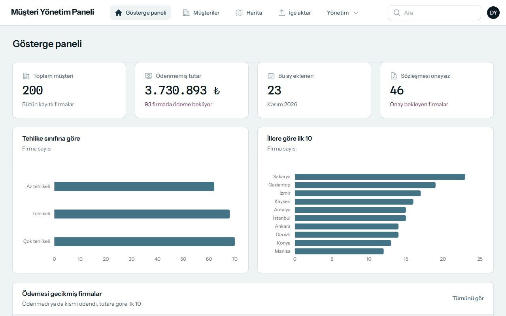
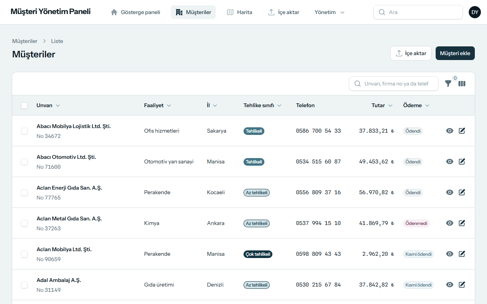
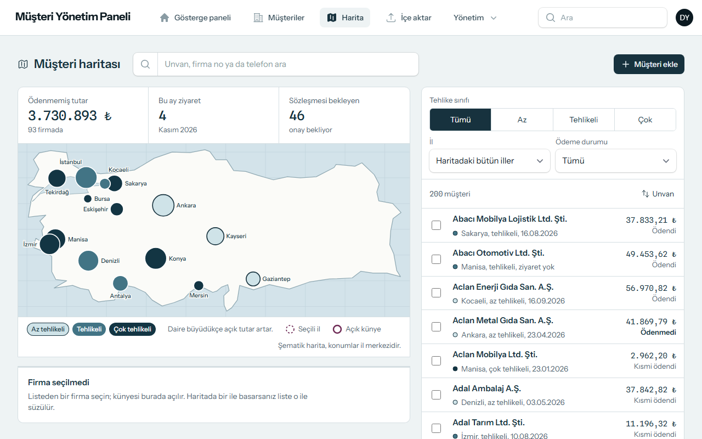
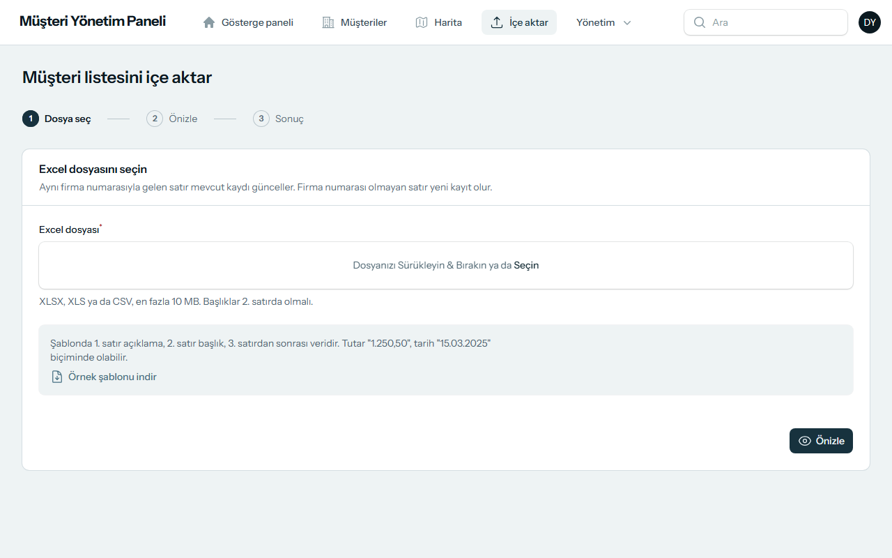
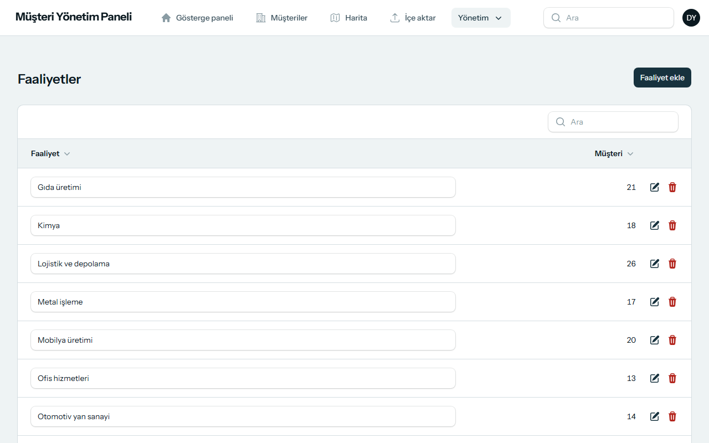
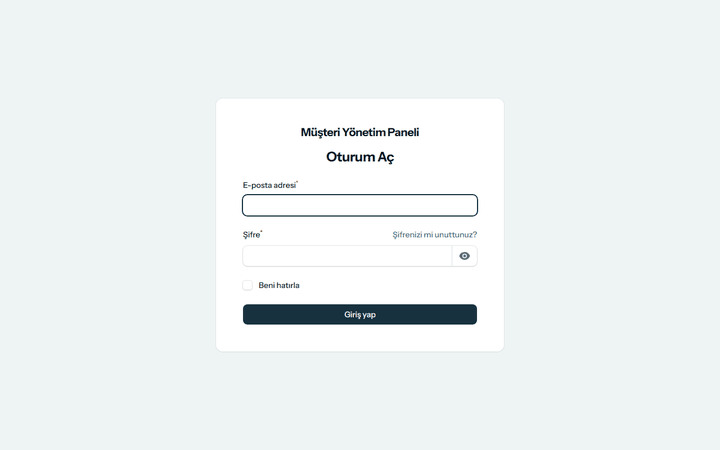

# Müşteri Yönetim Paneli

İş sağlığı ve güvenliği hizmeti veren bir firmanın müşteri listesini yöneten panel. Firmaları tehlike sınıfı, fatura ve ödeme durumu, saha ziyareti ile birlikte tutar. Yetkiyi rol tabanlı Policy'ler belirler. Excel listesi önizlenerek içe aktarılır; her değişiklik denetim kaydına yazılır. Staj projesi olarak başladı; bu sürümde yalnız sahte (demo) veri bulunur.

[](https://github.com/rose-omer/MusteriYonetimPaneli/actions/workflows/ci.yml)


## Ekran görüntüleri

Görüntüler yerel demo hesabı ve seed verisiyle alındı. Firma adları ve tutarlar örnektir.

| | |
|---|---|
| <br>Giriş | <br>Gösterge paneli |
| <br>Müşteri listesi | <br>Müşteri haritası |
| <br>Excel içe aktarım | <br>Faaliyetler |

## Kullanım



Harita ile liste aynı ekrandadır. Bir ile basınca liste o ile süzülür; firma seçilince künyesi açılır.

## Özellikler

- Müşteri listesi: unvan, firma no ve telefonda arama; il, faaliyet, tehlike sınıfı, fatura, ödeme, sözleşme, tutar aralığı ve ziyaret tarihi filtreleri.
- Toplu işlemler: ödeme durumu ve fatura durumu değiştirme, seçilenleri Excel'e aktarma, silme.
- Gösterge paneli: toplam müşteri, ödenmemiş tutar, bu ay eklenen, sözleşmesi onaysız firma; tehlike sınıfı ve il dağılımı; gecikmiş ödemeler. Her kart ilgili filtreyle listeye gider.
- Excel içe aktarımı (3 adım): dosya seçimi, ilk 20 satırın önizlemesi ve hata sayısı, sonuç özeti. `firma_no` ile upsert; "1.250,50" ve "15.03.2025" gibi Türkçe biçimler çözülür; hatalı satırlar satır numarasıyla listelenir ve indirilebilir.
- KVKK: izleyici rolü telefonu maskeli görür (`0532 *** ** 67`). Ekleme, güncelleme, silme ve içe aktarım `customer_audits` tablosuna yazılır. Silinen müşteri 90 gün sonra `model:prune` ile kalıcı silinir.
- Kayıt kapalı. Yönetici kullanıcı ekler ve davet e-postası gönderir.
- Türkçe arayüz, açık/koyu tema, mobil uyum, klavye ile kullanım.

## Mimari

| Katman | Kullanılan |
|---|---|
| Çatı | Laravel 13, PHP 8.4+ |
| Panel | Filament 5 (Livewire 4, Tailwind CSS 4) |
| Excel | Laravel Excel 4 (PhpSpreadsheet 5) |
| Test | Pest 5, Larastan (seviye 6), Pint |
| Veritabanı | SQLite (demo); MySQL/PostgreSQL ile de çalışır |

Uygulama `MusteriYonetim/` klasöründedir. Önemli dosyalar:

- `app/Policies/CustomerPolicy.php`: yetki matrisi.
- `app/Enums/`: rol, tehlike sınıfı, fatura tipi, fatura durumu, ödeme durumu.
- `app/Filament/Resources/Customers/`: müşteri formu, tablosu ve detay ekranı.
- `app/Imports/CustomerRowMapper.php`: Excel sütunları, doğrulama kuralları, Türkçe biçim çözümü.
- `app/Filament/Pages/ImportCustomers.php`: içe aktarım akışı.
- `DESIGN.md`: renk, tip ve bileşen kuralları.

## Rol ve yetki matrisi

| İşlem | Yönetici | Düzenleyici | İzleyici |
|---|:---:|:---:|:---:|
| Müşteri listesi ve detay | Evet | Evet | Evet |
| Telefonu tam görme | Evet | Evet | Hayır (maskeli) |
| Müşteri ekleme ve düzenleme | Evet | Evet | Hayır |
| Toplu durum değişikliği, Excel'e aktarma | Evet | Evet | Hayır |
| Müşteri silme ve geri alma | Evet | Hayır | Hayır |
| Excel'den içe aktarma | Evet | Hayır | Hayır |
| Faaliyet ve kullanıcı yönetimi | Evet | Hayır | Hayır |

## Kurulum

Gerekenler: PHP 8.4+ (`intl`, `zip`, `gd`, `pdo_sqlite`), Composer 2, Node.js 20.19+.

```bash
cd MusteriYonetim
composer install
cp .env.example .env
php artisan key:generate
touch database/database.sqlite        # Windows: New-Item database\database.sqlite
php artisan migrate --seed
npm ci && npm run build
php artisan serve --port=8100
```

Panel: <http://localhost:8100/admin>

Demo hesapları (parola `password`, yalnız yerel kullanım içindir):

| E-posta | Rol |
|---|---|
| `admin@demo.test` | Yönetici |
| `editor@demo.test` | Düzenleyici |
| `izleyici@demo.test` | İzleyici |

`APP_ENV=demo` iken giriş kutusunun altında izleyici hesabı notu görünür.

Örnek içe aktarım dosyası: `MusteriYonetim/docs/ornek-musteri-listesi.xlsx` (panelde "Örnek şablonu indir" bağlantısı da aynı dosyayı üretir).

Kalıcı silme için zamanlayıcıyı çalıştırın: `php artisan schedule:work` (ya da cron ile `schedule:run`).

## Test ve kalite

```bash
cd MusteriYonetim
php artisan test
vendor/bin/pint --test
vendor/bin/phpstan analyse --memory-limit=1G
composer audit
```

GitHub Actions (`.github/workflows/ci.yml`) aynı adımları PHP 8.5 ile çalıştırır ve ön yüzü derler.

## Açık sorular

- Fatura tipi ve fatura durumu için eski ekranlar iki farklı liste kullanıyordu (`AYLIK/YILLIK/HAFTALIK` ve `W30/W45/HAZIRLANACAK`). Veri kaybı olmasın diye ikisi birleştirildi; doğru liste iş sahibine sorulmalı.
- Canlı bir kurulum varsa veri göçleri (enum, boolean, tarih, `faaliyet_id`) önce yedekte denenmeli. Tanınmayan değerler boşaltılır ve günlüğe yazılır.
